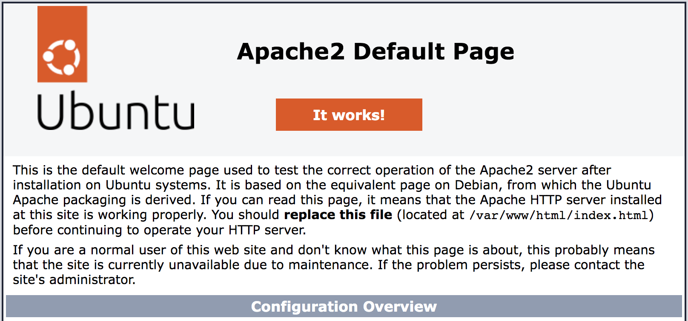

# Setup Apache

```shell
# install
sudo apt install apache2

# check status
sudo systemctl status apache2

# check version
apache2 -v
```

```console
Server version: Apache/2.4.66 (Ubuntu)
Server built:   2026-07-06T15:33:20
```

Also goto `http://your_server_or_ip` to check the default web page.



## .pgpass for www-data

```shell
# goto www-data user's home
cd /var/www

# edit .pgpass file add line per below
sudo vi .pgpass

# change owner
sudo chown www-data:www-data .pgpass

# change permissions on file so only www-data can use it
sudo chmod 600 .pgpass
```

